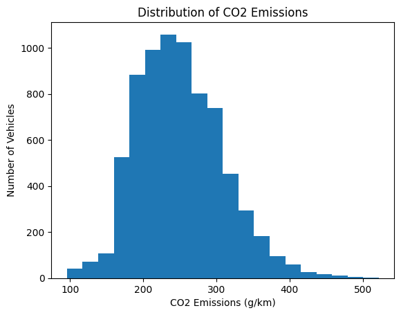
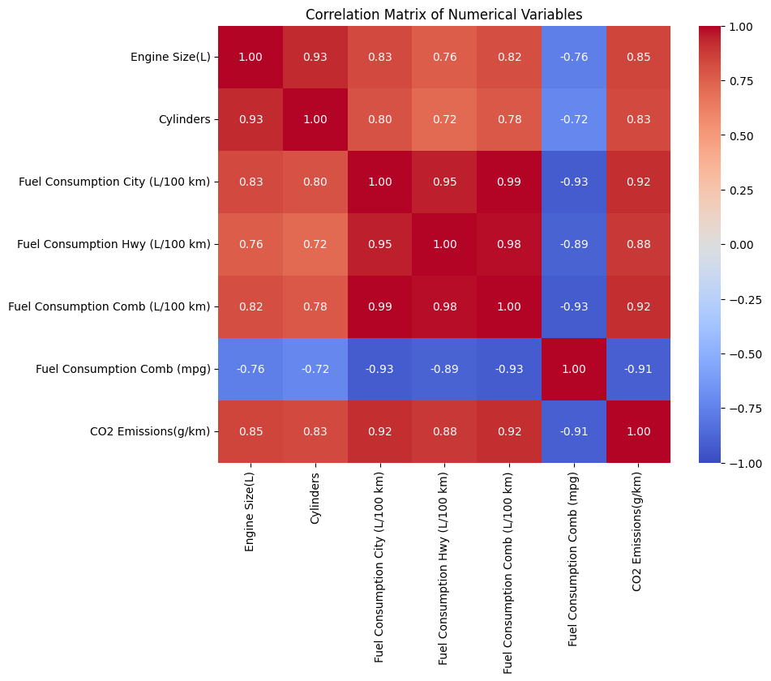
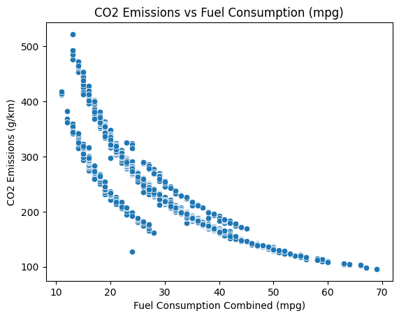
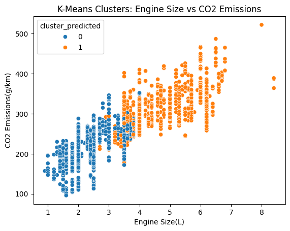

# CO2 Emissions Canada 

A supervised machine learning analysis of the [CO2 Emissions Canada](https://www.kaggle.com/datasets/debajyotipodder/co2-emission-by-vehicles) dataset, built to answer one question:

> **Which vehicle characteristics are linked to higher levels of CO2 emissions?**

The goal was to identify which vehicle design characteristics are most strongly tied to higher CO2 emissions, in order to suggest design changes that could help lower Canada's transportation carbon footprint.

## Dataset

- **Source:** Government of Canada vehicle fuel consumption ratings, via Kaggle ("CO2 Emissions Canada").
- **Size:** 7,385 raw rows → 6,282 rows after removing 1,103 duplicates. No missing values.
- **Scope:** Light-duty passenger vehicles only (excludes buses and heavy-duty trucks).
- **Columns:** `Make`, `Model`, `Vehicle Class`, `Engine Size(L)`, `Cylinders`, `Transmission`, `Fuel Type`, four fuel-consumption columns (City/Hwy/Comb in L/100km, Comb in mpg), and the target, `CO2 Emissions(g/km)`.

## Approach

This is a **supervised regression problem** — the target (`CO2 Emissions(g/km)`) is continuous. Two models were trained and compared on five design-level features (`Vehicle Class`, `Engine Size(L)`, `Cylinders`, `Transmission`, `Fuel Type`):

| Model | Features | R² (test) | MAE (g/km) | RMSE (g/km) |
| --- | --- | --- | --- | --- |
| Linear Regression (mpg only) | 1 | 0.8146 | 16.75 | 25.30 |
| Linear Regression | 5 | 0.7715 | 21.18 | 28.08 |
| **Random Forest** | 5 | **0.9318** | **11.06** | **15.34** |

`Make`, `Model`, and all four fuel-consumption columns (including mpg) were deliberately excluded from the main feature set: `Make`/`Model` have very high cardinality and wouldn't generalize to new vehicles, and the fuel-consumption columns are themselves downstream *outcomes* of a vehicle's design, not design characteristics — including them would leak the answer rather than explain it.

An unsupervised **K-Means clustering** step (k=2) was also run as an independent, target-free sanity check, and split vehicles into a lower-emission group (219.4 g/km avg) and a higher-emission group (309.8 g/km avg), the same pattern the regression models found.

## Key findings

- **Random Forest** explains 93.18% of the variance in CO2 emissions using only five design features, with no meaningful overfitting (train R² = 0.9515 vs. test R² = 0.9318).
- **Engine size is the single most influential feature** by a wide margin — its permutation importance (1.33) is more than 6× that of the next-highest feature, `Vehicle Class` (0.21). The Linear Regression coefficients agree: engine size has the largest coefficient (+23.44 g/km per litre), followed by `Cylinders` (+9.51 g/km per cylinder).
- `Transmission` and `Fuel Type` contribute comparatively little once engine size and vehicle class are accounted for.
- **Conclusion:** engine size (and, secondarily, vehicle class) is the most actionable design lever for reducing a vehicle's CO2 footprint.

## Visualizations

| | |
|---|---|
|  |  |
|  |  |

## Repository contents

```
.
├── notebook/
│   └── Project3_AnsweringQuestions.ipynb   # Full analysis: EDA, preprocessing, modeling, evaluation, interpretation
├── images/                                 # Charts generated in the notebook
├── presentation/
│   └── CO2_Emissions_Project3.pptx         # Slide deck summary of the project
└── README.md
```

## Tools

Python, pandas, NumPy, scikit-learn (Linear Regression, Random Forest, K-Means, permutation importance), matplotlib, seaborn.

## Author

Mariam Adekanye 
